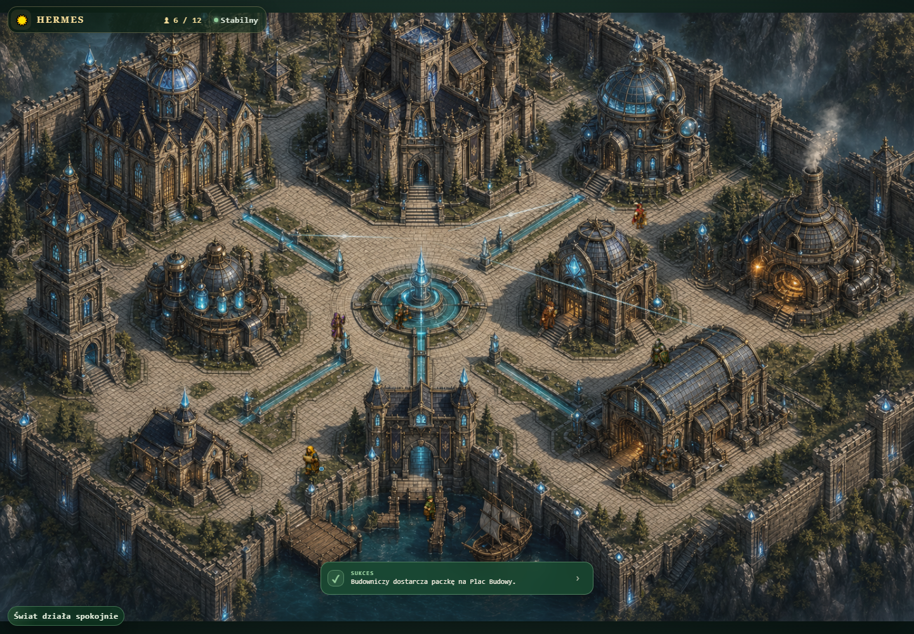

# Hermes OS — Living World

**Live observability for AI agents, rendered as a living Citadel.**

[Try the deployed product](https://hermes-os-panel.tail03d525.ts.net:10000/) · [Judge guide](docs/submission/JUDGE_GUIDE.md) · [Build Week disclosure](docs/submission/BUILD_WEEK.md) · [Architecture record](docs/build-week/05_ARCHITEKTURA_I_ZMIANY_PL.md) · [Test record](docs/build-week/06_TESTY_I_STABILNOSC_PL.md)



Hermes OS is a mobile-first observability and operations interface for a real multi-agent Hermes runtime. It turns workers, delegated tasks, reasoning, tool use, cron outcomes, logs, system telemetry and event lifecycles into a spatial interface called the Citadel.

**This is not an RPG or a scripted game scene.** A character represents a configured worker. A journey represents an observed task lifecycle. A building represents a real subsystem. Citadel Activity is built from named tasks, important runtime events and actual cron success/error results.

## Why it exists

Operating several AI agents usually means correlating profiles, logs, task boards, tool calls, cron history, machine health and network state. Hermes OS compresses those signals into a world that is readable in seconds while preserving the underlying operational evidence for inspection.

The core rule is simple: **the world must not invent system activity**. When authoritative data is unavailable, Hermes OS shows an unavailable or stale state instead of fabricating work.

## What judges can see

- A real roster of configured Hermes workers.
- End-to-end worker choreography: task assigned → travel → reasoning/tool work → completion → return.
- Citadel Activity containing semantic task events, important logs and cron success/error outcomes.
- Buildings that expose focused subsystem state rather than decorative interiors.
- Live, stale, unavailable and reconnect states with explicit provenance.
- Mobile-first operation with the same world model on desktop.
- A production event bridge, durable event history, SSE replay and reconnect resynchronization.

## Live architecture

```text
Hermes runtime / gateway
  ├─ profiles, tasks, crons, logs, sessions and telemetry
  └─ live state database events
            │
            ▼
Python watcher in WSL
            │ privacy-reduced JSONL journal
            ▼
Node event forwarder
            │ POST /api/world/events
            ▼
Express event hub ── durable bounded history ── shared SSE
            │
            ▼
WorldBridge snapshots + event reducer + reconnect/resync
            │
            ▼
Zustand world state
            │
            ├─ React/CSS Citadel
            └─ optional PixiJS enhancement
```

Operational truth flows in one direction:

`Hermes → adapters/API → event hub → snapshot/SSE → WorldBridge → state store → presentation`

The renderer never becomes the source of truth.

## Technology

- GPT-5.6 and Codex
- ChatGPT image generation for original visual references and effects
- React 19 and Vite 8
- Zustand 5
- PixiJS 8
- Express 5 and Node.js
- Python and WSL2
- Server-Sent Events
- PWA and Tailscale Funnel

## Run locally

### Requirements

- Node.js 20 or newer
- npm
- A Hermes installation for real authenticated runtime data
- WSL2 and Python for the live gateway watcher

### Install and validate

```bash
npm ci
npm test
npm run lint
npm run build
```

### Start the production server

```bash
npm start
```

The default production port is `4175`. Override it with the `PORT` environment variable.

### Useful environment variables

Copy `.env.example` and provide secrets only through your local environment. Never commit credentials.

| Variable | Purpose |
|---|---|
| `PORT` | Express/static server port; defaults to `4175` |
| `HERMES_WORLD_EVENT_HISTORY` | Durable world-event history file |
| `HERMES_CRON_LOG` | Hermes cron/log source path |
| `HERMES_WORLD_INGEST_TOKEN` | Optional event-ingestion bearer token |
| `HERMES_WEBUI_COOKIE_NAME` | Upstream Hermes session cookie name |
| `HERMES_WEBUI_COOKIE` | Local forwarder authentication cookie; never commit it |
| `VITE_ENABLE_PIXI_WORLD` | Enables the optional PixiJS enhancement |

The hosted judge instance is already configured. Credentials are supplied privately in the Devpost testing instructions and are intentionally absent from this repository.

## Live-event bridge

The validated deployment uses two explicit adapters:

- `scripts/hermes-gateway-world-adapter.py` watches the real Hermes state database and writes privacy-reduced structured events.
- `scripts/hermes-world-event-adapter.mjs` follows that journal and forwards events to `/api/world/events`.

Read the scripts' built-in argument help before starting them; database paths, journals, endpoints and tokens are environment-specific. The adapter boundary deliberately excludes raw private prompt and message content.

## Testing and release evidence

At the validated release snapshot:

- 178 tracked code files in the measured runtime/test scope;
- 22,162 physical lines of code;
- 18,651 production-code lines;
- 3,511 test-code lines across 24 test files;
- documented regression gate: **178/178 passing**;
- Build Week delta from the documented baseline: 180 commits, 295 changed files, 27,600 insertions and 371 deletions.

Release identity:

- commit: `c18bc52dfde75395549d41ea4cebdcdef745546f`
- validated tag: `demo-validated-2026-07-18`
- production tag: `prod-live-20260719`

The repository includes the chronological Build Week journal, Codex session register, architecture decisions, test reports and release evidence under [`docs/build-week`](docs/build-week/README_PL.md). The detailed record is currently retained in Polish because it is the original contemporaneous evidence; the judge-facing summary is in English.

## Built during OpenAI Build Week

Hermes OS began as a documented product foundation immediately after the GPT-5.6 preview. During the submission period it was meaningfully extended and completed with the real event bridge, telemetry-driven living world, subsystem interiors, full worker choreography, semantic task/cron activity, SSE and reconnect hardening, production deployment and an evidence-backed release process.

The pre-period baseline and Build Week delta are not blurred together. See [`docs/submission/BUILD_WEEK.md`](docs/submission/BUILD_WEEK.md) and [`docs/build-week/01_PROVENANCE_I_BASELINE_PL.md`](docs/build-week/01_PROVENANCE_I_BASELINE_PL.md).

## How Codex and GPT-5.6 were used

Codex was part of the complete engineering loop: architecture, implementation, debugging, tests, performance checks, browser validation, release evidence and documentation. Human approval remained the gate for product scope, real-device validation and production deployment.

Primary `/feedback` Session ID: `019f4f11-14e9-70e0-8d61-26226257864c`

Supporting final-release session: `019f76b1-bba0-7400-9167-0fab397eabc8`

## Known boundaries

- The hosted judge experience requires credentials supplied privately.
- The live bridge currently targets the author's Windows + WSL Hermes installation.
- A newly invoked worker may take roughly 2–4 seconds to become visually active while the real lifecycle is handed off.
- Signals without authoritative Hermes endpoints are intentionally absent rather than simulated.

## Repository map

- `src/` — React interface, renderer-neutral world model, reducers and tests
- `server/` and `server.js` — authenticated gateway, event ingestion, history and SSE
- `scripts/` — live Hermes watcher, journal forwarder and validation utilities
- `public/` — runtime visual assets and PWA files
- `docs/build-week/` — provenance, journal, Codex sessions, decisions, tests and evidence
- `docs/submission/` — concise English judge documentation
- `artifacts/validation/` — selected desktop and mobile validation screenshots

## Intellectual property and privacy

Visual assets were created for this project or are covered by the repository's notices. No private credentials, runtime databases, cookies, tokens or raw private conversations belong in Git. See [`THIRD_PARTY_NOTICES.md`](THIRD_PARTY_NOTICES.md).

Copyright © 2026 Filip. Source is shared for hackathon evaluation. No redistribution license is granted unless a separate license is added by the owner.
